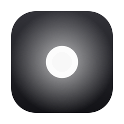
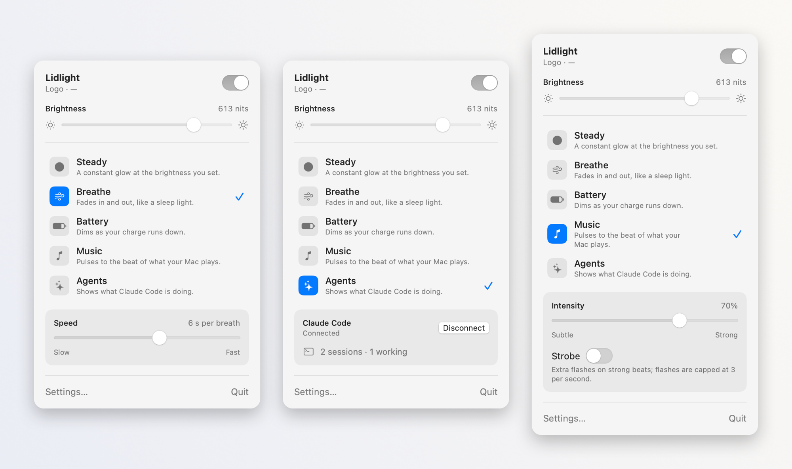
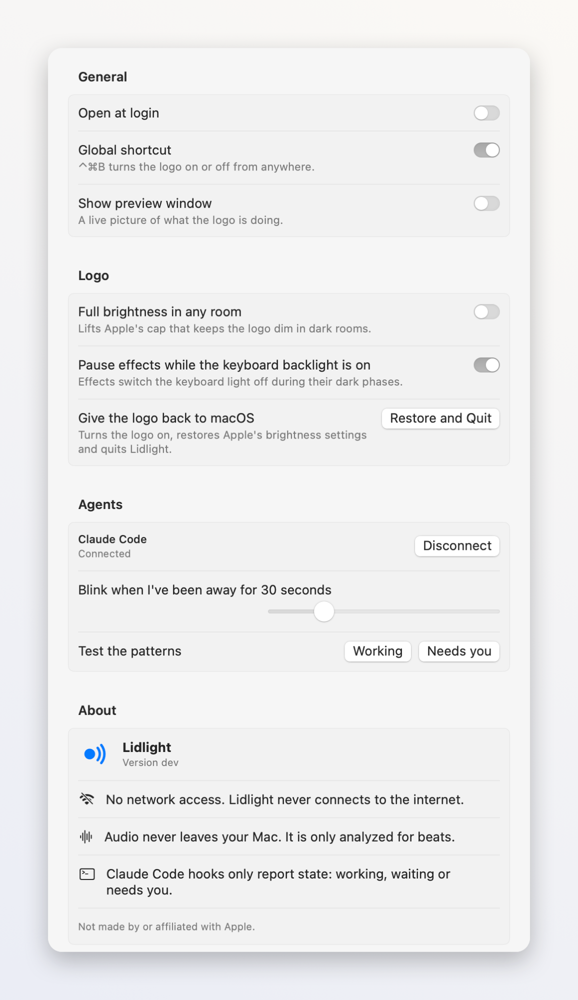
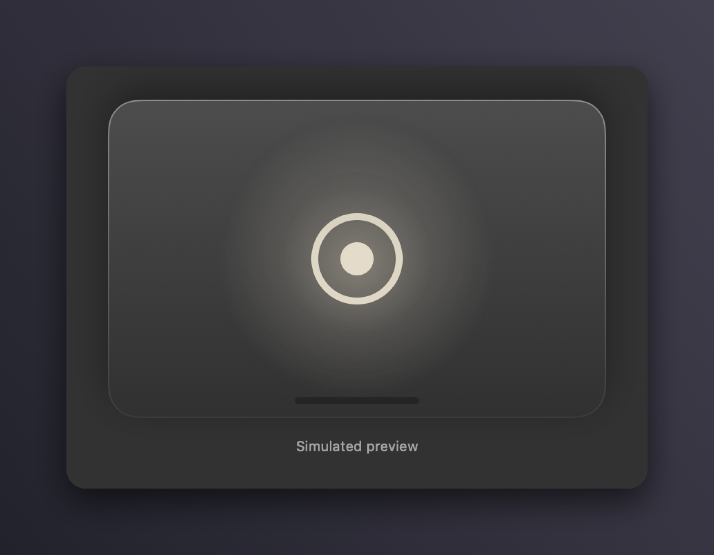

<p align="center">
  
</p>

<h1 align="center">Lidlight</h1>

<p align="center">
  A free, open-source menu bar app for the glowing logo on the lid of the new MacBook Pro.<br>
  Set how bright it glows, turn it off, or bring it to life.
</p>

<p align="center">
  <a href="https://github.com/karimbacchus/lidlight/releases/latest"><b>Download the latest release</b></a>
  ·
  <a href="#build-from-source">Build from source</a>
  ·
  <a href="docs/HARDWARE.md">How it works</a>
</p>

<picture>
  <source media="(prefers-color-scheme: dark)" srcset="docs/images/hero-dark.png">
  
</picture>

macOS decides how bright the lid logo glows from your screen brightness and the light in the room, and
gives you no setting for it. Lidlight does.

## Modes

| | Mode | What the logo does |
|---|---|---|
| ● | **Steady** | A constant glow at the brightness you set. |
| ≋ | **Breathe** | Fades in and out, one breath every 3–10 seconds — like the old MacBook sleep light. |
| ▭ | **Battery** | Dims as your charge runs down, and pulses slowly below 10 %. |
| ♪ | **Music** | Pulses to the beat of whatever your Mac plays, with an intensity slider and an optional strobe (capped at 3 flashes a second). |
| ✦ | **Agents** | A status light for [Claude Code](https://claude.com/claude-code): a soft glow while it waits, a pulse while it works, and double blinks when it needs you and you've stepped away. |

Plus:

- **Off in one click** — or press <kbd>⌃</kbd><kbd>⌘</kbd><kbd>B</kbd> from any app, or Option-click the menu bar icon.
- **Full brightness in any room** — lifts the cap macOS puts on the logo in dark rooms. No password needed.
- **Never touches your screen brightness**, and puts Apple's settings back when you quit — even if Lidlight crashes.
- **A live preview window** that shows what the logo is doing.

The menu bar icon tells you the state at a glance: a dot when the logo is on, a ring when it's off, and a
dot with a wave while a mode is animating.

<p align="center">
  
  &nbsp;
  
</p>

## Install

1. Download `Lidlight.zip` from the [latest release](https://github.com/karimbacchus/lidlight/releases/latest).
2. Unzip it and drag **Lidlight** to your Applications folder.
3. Open it. A dot appears in your menu bar — if your menu bar is crowded, it may be tucked behind the notch
   or a menu bar manager.

Requires a **MacBook Pro with PROLED XDR Display** (the one with the glowing logo) and macOS 14 or later.
On other Macs Lidlight opens in a preview mode that simulates the logo.

### Music

Music listens to what your Mac plays — never the microphone — and only measures how hard the bass is
hitting. Nothing is recorded, saved or sent anywhere. The first time, macOS asks you to allow it under
**System Settings › Privacy & Security › Screen & System Audio Recording**.

### Agents (Claude Code)

Choose **Agents** and click **Connect**. Lidlight adds a few hooks to `~/.claude/settings.json` so it knows
when Claude Code is working, waiting or needs you. It never sees your prompts or code. **Disconnect** in
Settings removes exactly those hooks and nothing else.

## Privacy

Lidlight has no accounts, no analytics and makes no network connections. Settings stay in your user
defaults; audio analysis happens in memory.

## How it works

The logo is a white LED driven by `corebrightnessd`. Lidlight talks to it through Apple's private
CoreBrightness framework — the same settings Apple's own `defaults write com.apple.CoreBrightness
LEBacklightMode` command changes — so it needs no password and no kernel extension:

- **On/off** uses the logo's own on/off setting.
- **Brightness** rewrites the logo's brightness tables (screen brightness → logo brightness, and the
  ambient-light limits). macOS applies them the next time it updates the logo.
- **Animations** use the logo's built-in fade: macOS itself ramps the light smoothly at 60 Hz.

Every finding, measurement and safety rule is documented in [docs/HARDWARE.md](docs/HARDWARE.md); the
design is in [docs/PLAN.md](docs/PLAN.md).

### Known limits

- Brightness changes take effect at macOS's next logo update (usually when your screen brightness or the
  room light changes), not instantly.
- The logo's fade signal also reaches the **keyboard backlight**. Lidlight restores it within a few
  milliseconds, so it stays lit; if you still notice a flicker, Settings has an option to pause effects
  while the keyboard backlight is on.
- It relies on private macOS interfaces, so a macOS update can change or break it.
- The logo is white — no app can change its color.

## Removing Lidlight

1. Open Lidlight and make sure the logo is on.
2. In Settings, click **Disconnect** for Agents if you connected Claude Code.
3. Quit Lidlight (it restores Apple's logo settings) and delete it from Applications.

If the logo stays dark, run Apple's command: `sudo defaults delete com.apple.CoreBrightness LEBacklightMode`.

## Build from source

Needs macOS 14+ and the Xcode Command Line Tools (`xcode-select --install`) — Xcode itself isn't required.

```bash
git clone https://github.com/karimbacchus/lidlight.git
cd lidlight
make app        # builds build/Lidlight.app
make run        # builds and opens it
make run-sim    # runs with a simulated logo, no hardware changes
make checks     # runs every module's checks
```

`Contents/Helpers/lidlightctl` inside the app is a small CLI: `lidlightctl status`, `on`, `off`,
`level <nits>`, `restore`. `scripts/hardware-smoke.sh` runs a one-minute live test on a Mac with the logo.

Releases are built with `scripts/release.sh`, which signs with a Developer ID and notarizes the app.

## License

[MIT](LICENSE). Lidlight is an independent project and is not made by or affiliated with Apple.
"MacBook Pro" is a trademark of Apple Inc.
